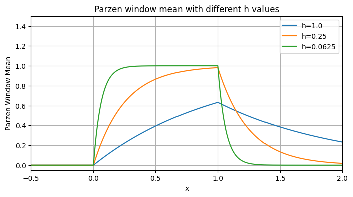
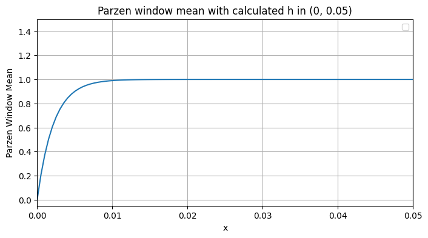
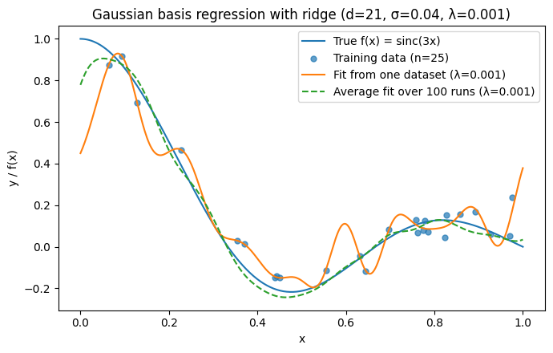
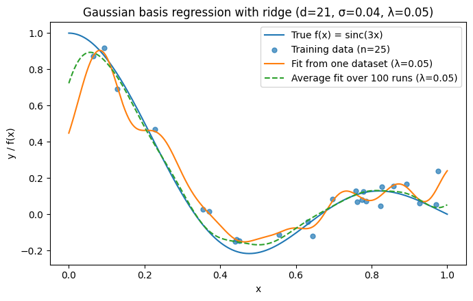
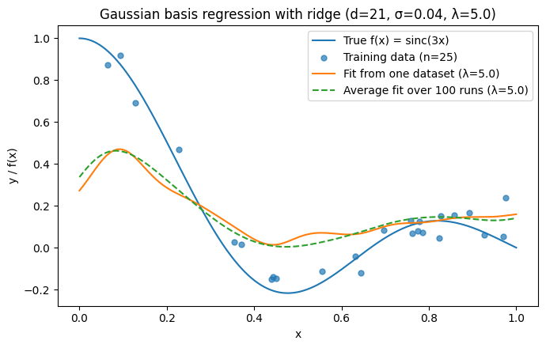
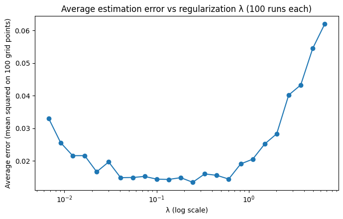

# Density Estimation, Classification & Ridge Regression

A Python/Jupyter implementation of four machine learning exercises: **Parzen-window density estimation**, **nonparametric classification**, **Gaussian maximum-likelihood estimation**, and **Gaussian basis function regression with ridge regularization**.

## At a glance

| Exercise | Approach | Main result |
| --- | --- | --- |
| Q1 | Piecewise Parzen-window mean, multiple bandwidths | Curves for `h = 1, 0.25, 0.0625`, plus a close-up at `h = 0.0021714724` |
| Q10 | Gaussian-kernel class scores for three classes | All three test vectors predicted as **ω₂** for both `h = 1.0` and `h = 0.1` |
| Q11 | Closed-form and numerical Gaussian MLE | Mean ≈ **100.4805**, variance ≈ **216.31847**; optimizer succeeded |
| Q12 | Gaussian radial basis functions + ridge regression | Lowest observed average error ≈ **0.0134505** at **λ ≈ 0.246597** |

## Repository layout

```text
.
├── README.md
├── ML_Assignment_2.ipynb
├── requirements.txt
└── assets/
    ├── parzen_bandwidth_comparison.png
    ├── parzen_small_bandwidth.png
    ├── ridge_lambda_0_001.png
    ├── ridge_lambda_0_05.png
    ├── ridge_lambda_5.png
    └── ridge_error_vs_lambda.png
```

> **Dataset note:** The original notebook's Q11 loads `normal.data.txt`, but that file was **not included** with the uploaded notebook. Q11's saved numerical output is reported below, but executing that cell from scratch requires you to put the original `normal.data.txt` alongside the notebook. The remaining exercises generate or define their data inside the notebook.

## Installation and execution

Use Python 3 with Jupyter installed:

```bash
python -m venv .venv
# macOS/Linux:
source .venv/bin/activate
# Windows PowerShell: .venv\Scripts\Activate.ps1

pip install -r requirements.txt
jupyter notebook ML_Assignment_2.ipynb
```

Run cells from top to bottom. **Question 11 requires `normal.data.txt`** in the working directory. If it is unavailable, skip its cell to run Question 12; the other questions do not depend on it. The notebook includes saved figures and printed outputs for review without rerunning.

## Question 1 — Parzen-window density estimation

### Method

The notebook evaluates a piecewise kernel-smoothed density expression for a target distribution supported on `(0, a)`:

$$
\bar p_h(x)=
\begin{cases}
0, & x\leq 0,\\
\frac{1}{a}\left(1-e^{-x/h}\right), & 0<x\leq a,\\
\frac{1}{a}\left(e^{a/h}-1\right)e^{-x/h}, & x>a.
\end{cases}
$$

The implementation uses `a = 1`. It illustrates how bandwidth `h` changes the smoothness and concentration of the estimate. This formula is the **implemented analytical Parzen-window mean**, not a sample-based Parzen estimator.

### Results

Bandwidths `h = 1.0`, `0.25`, and `0.0625` are compared over a broad interval. A second plot zooms into `x ∈ [0, 0.05]` with `h = 0.0021714724`.





**Observation:** Smaller bandwidths create a sharper rise near the support boundary and a more concentrated curve. The plots demonstrate bandwidth sensitivity, not an empirical model accuracy comparison.

## Question 10 — Gaussian-kernel classification

### Method

Three labeled classes, `ω₁`, `ω₂`, and `ω₃`, each contain **10 samples in 3 dimensions**. For a query vector $\mathbf x$, the notebook computes a Gaussian-kernel similarity score for each class:

$$
S_k(\mathbf x;h)=\sum_{\mathbf x_i\in\omega_k}
\exp\left(-\frac{\|\mathbf x-\mathbf x_i\|_2^2}{2h^2}\right).
$$

It assigns the class with the largest score:

$$
\hat k(\mathbf x)=\arg\max_{k\in\{1,2,3\}} S_k(\mathbf x;h).
$$

Since all three classes have equal numbers of samples, using these unnormalized scores does not change the predicted class compared with normalized Gaussian Parzen density estimates under equal class priors.

### Results

| Test vector $(x_1,x_2,x_3)$ | Prediction at $h=1.0$ | Prediction at $h=0.1$ |
| --- | --- | --- |
| (0.50, 1.00, 0.00) | **ω₂** | **ω₂** |
| (0.31, 1.51, −0.50) | **ω₂** | **ω₂** |
| (−0.30, 0.44, −0.10) | **ω₂** | **ω₂** |

Class similarity scores printed by the notebook:

| Bandwidth | Test vector | $S_1$ | $S_2$ | $S_3$ |
| --- | --- | ---: | ---: | ---: |
| 1.0 | (0.50, 1.00, 0.00) | 1.25919 | **4.71078** | 3.77466 |
| 1.0 | (0.31, 1.51, −0.50) | 1.53439 | **4.82796** | 2.05040 |
| 1.0 | (−0.30, 0.44, −0.10) | 1.39908 | **3.78254** | 1.77066 |
| 0.1 | (0.50, 1.00, 0.00) | 8.77e−22 | **6.77e−7** | 8.00e−19 |
| 0.1 | (0.31, 1.51, −0.50) | 2.87e−22 | **1.20e−7** | 2.16e−27 |
| 0.1 | (−0.30, 0.44, −0.10) | 3.64e−14 | **3.78e−6** | 1.06e−41 |

**Observation:** All three predictions remain ω₂ across both bandwidths, although the absolute kernel scores become much smaller at the narrower bandwidth.

## Question 11 — Gaussian maximum-likelihood estimation

### Method

Assume independent scalar observations $x_1,\ldots,x_n$ from $\mathcal N(\mu,\sigma^2)$. The maximum-likelihood estimators are:

$$
\hat\mu=\frac{1}{n}\sum_{i=1}^n x_i,
\qquad
\hat\sigma^2=\frac{1}{n}\sum_{i=1}^n(x_i-\hat\mu)^2.
$$

The notebook also minimizes the Gaussian negative log-likelihood:

$$
\mathrm{NLL}(\mu,\sigma^2)
=\frac{n}{2}\log(2\pi)+\frac{n}{2}\log(\sigma^2)
+\frac{1}{2\sigma^2}\sum_{i=1}^n(x_i-\mu)^2.
$$

It optimizes `log(σ²)` rather than `σ²` directly to keep the variance positive, using `scipy.optimize.minimize`.

### Results (saved notebook output)

| Estimator | Mean $\hat\mu$ | Variance $\hat\sigma^2$ |
| --- | ---: | ---: |
| Closed form | 100.4805 | 216.31846975 |
| Numerical optimization | 100.4805 | 216.31846975 |

**Optimizer success:** `True`.

The two methods agree to the displayed precision. **Reproduction limitation:** `normal.data.txt` is missing from this repository package because it was not supplied; these are results preserved from the original notebook output, not newly rerun estimates.

## Question 12 — Gaussian basis function regression and ridge regularization

### Data generation

Synthetic observations are drawn from:

$$
y_i=f(x_i)+\varepsilon_i,
\quad f(x)=\mathrm{sinc}(3x),
\quad x_i\sim U(0,1),
\quad \varepsilon_i\sim\mathcal N(0,0.01).
$$

NumPy's convention is $\mathrm{sinc}(t)=\sin(\pi t)/(\pi t)$, with value 1 at $t=0$. Each generated training dataset contains **25 observations**.

### Gaussian basis model

The model uses **21 Gaussian basis functions** with evenly spaced centers $c_j$ on $[0,1]$ and width $\sigma=0.04$:

$$
\phi_j(x)=\exp\left(-\frac{(x-c_j)^2}{2\sigma^2}\right),
\qquad
\hat f(x)=\beta_0+\sum_{j=1}^{21}\beta_j\phi_j(x).
$$

Let $\Phi$ be the design matrix including a column of ones, and $R=\mathrm{diag}(0,1,\ldots,1)$ so the intercept is not penalized. The estimator is:

$$
\hat{\boldsymbol\beta}_\lambda
=(\Phi^\top\Phi+\lambda R)^{-1}\Phi^\top\mathbf y.
$$

In code, this linear system is solved using `numpy.linalg.solve` (rather than explicitly computing an inverse).

### Fits for three regularization strengths

For each $\lambda\in\{0.001,0.05,5.0\}$, the saved chart compares the true function, one fitted dataset, and the **average fitted coefficients over 100 independently generated datasets**. The initial dataset and experiment have a fixed random seed (`42`).

**λ = 0.001**



**λ = 0.05**



**λ = 5.0**



These plots illustrate the change in fit as regularization increases; very strong regularization limits model flexibility.

### Average prediction error across regularization strengths

For each regularization parameter, the experiment fits the model on **100 newly sampled datasets** and compares predictions to the true noise-free function at **100 evenly spaced grid points**:

$$
E(\lambda)=\frac{1}{100}\sum_{r=1}^{100}
\left[\frac{1}{100}\sum_{j=1}^{100}
\big(f(z_j)-\hat f_\lambda^{(r)}(z_j)\big)^2\right].
$$

Regularization candidates follow $\lambda=\exp(t)$, for `t = -5, -4.7, …` in increments of `0.3` up to the final grid point not exceeding `2`. The error experiment uses seed `123`.



| Metric | Saved result |
| --- | ---: |
| **Minimum average prediction error** | **0.013450496142847112** |
| **Regularization parameter at minimum** | **0.24659696394160596** |
| Datasets per candidate | 100 |
| Prediction evaluation grid points | 100 |

This is the **minimum of the tested λ grid**, not a claim of a globally optimal value. The error is against the known true synthetic function, not an external test set.

## Reproducibility notes

- Original notebook computations and saved outputs were preserved; only descriptive notebook headings were added.
- Fixed random seeds are used in Question 12 (`42` for fit plots, `123` for the error experiment).
- The figures under `assets/` were extracted from the notebook's **saved plot outputs**, so the README shows the actual recorded results rather than illustrations.
- Question 11 cannot be rerun until its original input data file is provided.

## Technologies

Python, NumPy, SciPy, Matplotlib, and Jupyter Notebook.
